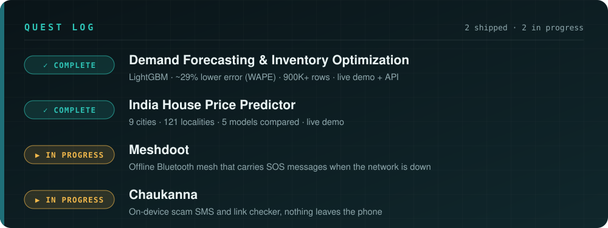
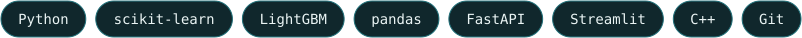

  

 

I build machine-learning projects from raw data to a deployed app, and I check my own results hard: baselines first, cross-validation, and being clear about what the data can and cannot show. Mathematics & Computing at Delhi Technological University.

  

## Shipped

| Project | What it does | Links |
|---|---|---|
| **Demand Forecasting & Inventory Optimization** | LightGBM forecasts on 900K+ sales records, about 29% lower error (WAPE) than a seasonal-naive baseline. Adds a safety-stock policy, a business simulation, a Streamlit dashboard and a FastAPI API. | [Code](https://github.com/shubham-builds-1/demand-forecasting-inventory-optimization) · [Live demo](https://demand-forecasting-dash.streamlit.app) |
| **India House Price Predictor** | Gradient-boosting price estimator for 9 cities and 121 localities, trained on synthetic data calibrated to 2026 asking-price benchmarks. The original pipeline compares 5 models with cross-validation. | [Code](https://github.com/shubham-builds-1/house-price-prediction) · [Live demo](https://house-price-predict-one.streamlit.app) |

## In progress

Both are for the SEVA FIRST Innovation Challenge 2026 at DTU, built with Tanush. Code goes up here once the first working version runs.

- **Meshdoot:** passes prioritised, location-tagged SOS messages between phones over Bluetooth when there is no network.
- **Chaukanna:** checks scam messages and lookalike links on the phone itself and explains the risk, with nothing uploaded.

## Tools

## Find me

[LinkedIn](https://www.linkedin.com/in/shubham-yadav-a7ab3a41a/)
