<!-- Generated by build.py from profile.json. Edit profile.json, not this file. -->

  

 

I build machine-learning projects from raw data to a deployed app, and I check my own results hard: baselines first, cross-validation, and being clear about what the data can and cannot show. Mathematics & Computing at Delhi Technological University.

  
    
  

## Projects

| Project | Status | Details | Links |
|---|---|---|---|
| **Demand Forecasting & Inventory Optimization** | Shipped | End-to-end pipeline on 900K+ sales records. LightGBM beats a seasonal-naive baseline, and a safety-stock policy plus a business simulation turn the forecasts into inventory decisions. Python · LightGBM · FastAPI · Streamlit | [Code](https://github.com/shubham-builds-1/demand-forecasting-inventory-optimization) · [Live demo](https://demand-forecasting-dash.streamlit.app) |
| **India House Price Predictor** | Shipped | Gradient-boosting price estimator for Indian cities, trained on synthetic data calibrated to 2026 asking-price benchmarks. The original pipeline compares five models with cross-validation. Python · scikit-learn · Streamlit · pytest | [Code](https://github.com/shubham-builds-1/house-price-prediction) · [Live demo](https://house-price-predict-one.streamlit.app) |
| **Meshdoot** | In progress | Offline Bluetooth mesh that passes prioritised, location-tagged SOS messages from phone to phone when the network is down. Critical messages get relayed first. Bluetooth LE · Mesh networking · Android <i>SEVA FIRST Innovation Challenge 2026, with Tanush</i> | Code coming soon |
| **Chaukanna** | In progress | On-device scam message and link checker for Hindi and English. It explains why a message looks risky, and nothing leaves the phone. On-device ML · TF-IDF · Android <i>SEVA FIRST Innovation Challenge 2026, with Tanush</i> | Code coming soon |

## Find me

[LinkedIn](https://www.linkedin.com/in/shubham-yadav-a7ab3a41a/)
